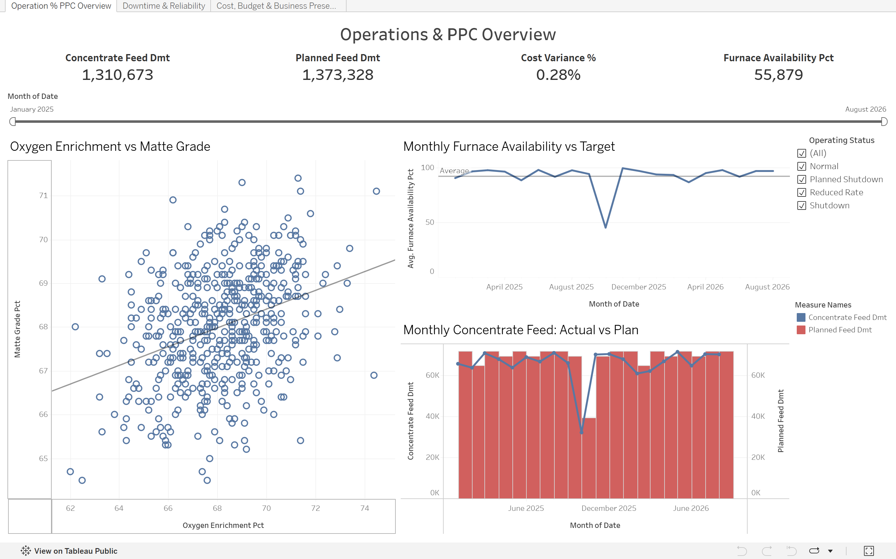
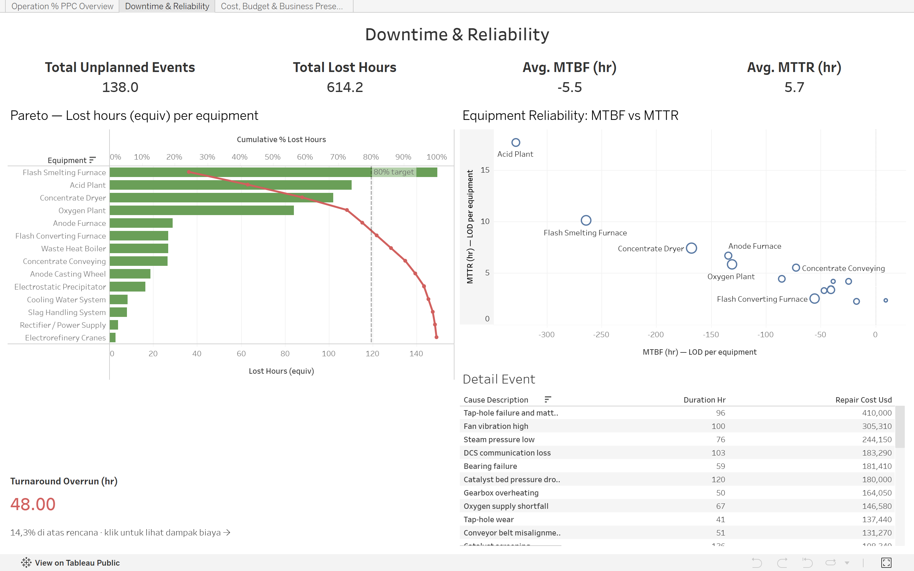
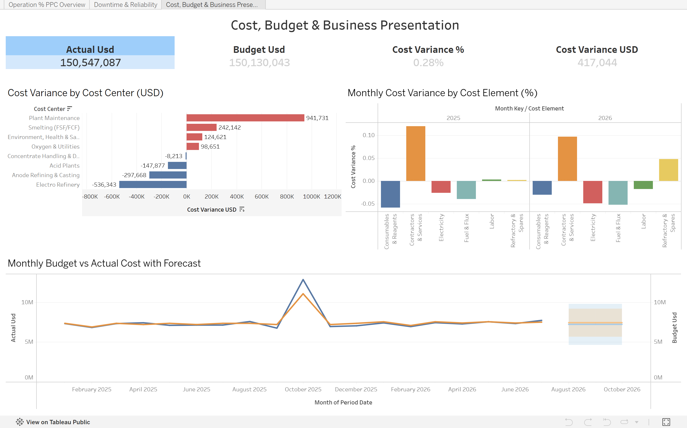

# PT Nusa Tembaga Smelting: Operational Reliability & Cost Efficiency Analysis

> **End-to-end analytics project** using PostgreSQL, Python (pandas/statsmodels), dan Tableau untuk mengidentifikasi titik kebocoran waktu dan biaya pada operasional smelter tembaga.

---

## Daftar Isi

1. [Business Understanding](#1-business-understanding)
2. [Data Source](#2-data-source)
3. [Environment & Tech Stack](#3-environment--tech-stack)
4. [Data Cleaning](#4-data-cleaning)
5. [Data Extraction & Feature Engineering](#5-data-extraction--feature-engineering)
6. [Key Findings](#6-key-findings)
7. [Dashboard](#7-dashboard)
8. [Insights & Strategic Recommendations](#8-insights--strategic-recommendations)
9. [Limitations & Methodology Notes](#9-limitations--methodology-notes)

---

## 1. Business Understanding

### 1.1 Business Background

PT Nusa Tembaga Smelting adalah **perusahaan fiktif** yang merepresentasikan smelter tembaga berbasis Flash Smelting Furnace (FSF) — mengikuti konvensi industri peleburan tembaga pada umumnya (concentrate drying → smelting → converting → anode refining → electrorefinery, dengan SO2 off-gas diproses menjadi asam sulfat di Acid Plant). Proyek ini dibangun sebagai studi kasus untuk melamar posisi **Data Analyst** di industri pertambangan/smelter (mengacu pada job posting Data Analyst — PT Amman Mineral Nusa Tenggara), yang mencakup analisis operasional plant, benchmarking dengan peer, cost report, budgeting, production planning & control (PPC), dan data cleaning rutin/ad-hoc.

Dataset mencakup operasi harian **Januari 2025 – Agustus 2026** (608 hari), dengan plan dan budget hingga Desember 2026.

### 1.2 Business Problem

Analisis mengidentifikasi dua masalah utama yang mengancam efisiensi waktu dan biaya operasional plant:

- **Problem 1 — Downtime Concentration**: Plant mengalami downtime tak terencana yang tersebar di 14 equipment berbeda, namun belum ada analisis sistematis tentang *equipment mana* yang paling layak diprioritaskan untuk investasi maintenance.
- **Problem 2 — Cost Overrun saat Turnaround**: Ada indikasi kuat bahwa overrun biaya tahunan tidak tersebar merata — sebagian besar kemungkinan terkonsentrasi pada event tertentu (turnaround/shutdown terencana), namun penyebab spesifiknya (material vs jasa kontraktor) belum teridentifikasi.

### 1.3 Project Objectives

| # | Objective | Analysis Focus |
|---|---|---|
| 1 | Identifikasi equipment dan kategori kegagalan yang paling berkontribusi terhadap downtime tak terencana | Downtime & Reliability (Pareto, MTBF/MTTR) |
| 2 | Kuantifikasi dampak waktu dan biaya dari event turnaround terhadap budget tahunan | Cost & Budget Variance |
| 3 | Mengukur posisi plant terhadap peer smelter tembaga lain untuk identifikasi area perbaikan | Benchmarking |
| 4 | Menilai kesesuaian plan vs actual produksi dan dampak tren kadar bijih terhadap PPC | Operations & PPC |

### 1.4 Key Business Questions (KBQ)

**Objective 1 — Downtime & Reliability:**
- Equipment mana yang paling banyak menyumbang lost production time?
- Apakah pola kegagalan tiap equipment itu sering-tapi-cepat diperbaiki, atau jarang-tapi-lama?

**Objective 2 — Cost & Budget:**
- Berapa besar overrun biaya pada bulan turnaround dibanding bulan-bulan normal?
- Cost element mana (material, listrik, tenaga kerja, kontraktor) yang paling mendorong overrun tersebut?

**Objective 3 — Benchmarking:**
- Di KPI mana plant ini tertinggal paling jauh dari kuartil teratas peer?

**Objective 4 — PPC:**
- Apakah availability plant konsisten mencapai target perencanaan?
- Bagaimana tren kadar Cu feed memengaruhi asumsi target produksi ke depan?

---

## 2. Data Source

**Jenis data:** Dataset sintetis (synthetic), dibuat untuk tujuan portofolio — bukan data operasional perusahaan sungguhan.

| Tabel | Deskripsi | Kolom | Granularitas |
|---|---|---|---|
| `daily_operations` | Feed, grade, produksi (matte/anode/cathode/acid), availability, konsumsi energi | 20 | Harian |
| `downtime_events` | Event downtime terencana & tak terencana per equipment | 14 | Per event (254 event) |
| `production_plan` | Plan/budget produksi bulanan (PPC) | 13 | Bulanan |
| `concentrate_stock` | Neraca stok konsentrat bulanan | 8 | Bulanan |
| `cost_report` | Budget vs actual per 8 cost center × 6 cost element | 10 | Bulanan |
| `peer_benchmark` | 10 peer smelter anonim + own plant | 13 | Tahunan (2024–2025) |
| `market_reference` | Harga LME tembaga, kurs USD/IDR, harga BBM, tarif listrik | 5 | Bulanan |

**Data quality:** seluruh tabel sengaja disisipkan **186 data quality issue** (missing value, salah desimal, unit mismatch, sign error, salah mata uang, label tidak konsisten, duplikat, stok tidak rekonsiliasi) untuk melatih dan mendemonstrasikan proses data cleaning.

---

## 3. Environment & Tech Stack

**Tools:** PostgreSQL/DBeaver (data cleaning & EDA) · Python — pandas, numpy, statsmodels, scipy, matplotlib, seaborn (EDA lanjutan, regresi, forecast) · Tableau Desktop/Public (dashboard utama) · struktur pendamping untuk Power BI (DAX) dan Looker Studio (tabel ringkasan statistik)

**Alur kerja:** CSV sintetis → PostgreSQL (`raw` → `clean` schema) → Python (statistik lanjutan) → Tableau (visualisasi & storytelling)

---

## 4. Data Cleaning

Seluruh cleaning dilakukan di PostgreSQL (`cleaning_postgresql.sql`), menghasilkan schema `clean.*` yang jadi fondasi seluruh analisis lanjutan.

### 4.1 Strategi Cleaning per Tabel

**`daily_operations`**
- Dedup berdasarkan `record_id` (pakai `ctid`)
- Parsing tanggal campur format (`DD/MM/YYYY` vs `YYYY-MM-DD`)
- Standardisasi label `operating_status` (`TRIM` + `lower` + mapping)
- Koreksi range-based: typo desimal grade (Cu % di luar 15–35 → ×/÷10), unit mismatch energi (kWh tertulis sebagai MWh → ÷1000), sign error produksi asam (nilai negatif → `ABS()`)
- Imputasi median per bulan untuk missing value (hanya dari hari operasi normal, availability > 90%)

**`downtime_events`**
- Mapping nama equipment yang tidak konsisten (`"FSF"`, `"flash smelting furnace"` → `"Flash Smelting Furnace"`)
- Rekonstruksi `end_datetime` yang hilang dari `start + duration`
- `ABS()` untuk durasi negatif

**`cost_report`**
- Standardisasi nama cost center
- Deteksi & koreksi sign error (`actual_usd` negatif tapi budget positif → dibalik)
- Deteksi salah mata uang (actual > 100× budget → kemungkinan IDR tertulis di kolom USD, dikonversi pakai kurs bulan terkait)
- **Audit kolom `is_missing_actual_flag`**: TRUE jika actual masih kosong di periode Closed — **tidak dianggap 0**, agar tidak meremehkan angka cost

**`concentrate_stock`**
- Rekonstruksi `closing_stock_calculated_dmt = opening + receipts - feed`
- **Audit kolom `reconciliation_status`**: `"Needs investigation"` jika selisih reported vs calculated > 1% dari feed bulanan — closing stock reported **tetap jadi angka resmi**, bukan ditimpa otomatis, karena penyebab selisih perlu dikonfirmasi ke pemilik proses

**`peer_benchmark`**
- Konversi placeholder teks `"n/a"` di kolom numerik menjadi NULL

### 4.2 Prinsip Audit

Setiap tabel yang butuh validasi punya kolom audit eksplisit (`is_missing_actual_flag`, `reconciliation_status`) alih-alih menyembunyikan ketidakpastian sebagai angka 0 — prinsip ini konsisten dipakai di semua query turunan.

---

## 5. Data Extraction & Feature Engineering

### 5.1 Metrik Operasional & Reliability

| Metrik | Definisi |
|---|---|
| **Feed Cu % (weighted)** | `SUM(feed × grade) / SUM(feed)` — bukan rata-rata sederhana, karena volume harian bervariasi |
| **Cu Recovery to Matte %** | `Cu dalam matte / Cu dalam feed` |
| **Lost Hours (equiv)** | `duration_hr × throughput_loss_pct / 100`, hanya untuk event `is_planned='N'` dan `impact_type <> 'No Impact'` |
| **MTBF (Mean Time Between Failures)** | `(total jam periode − total downtime) / jumlah kegagalan`, per equipment |
| **MTTR (Mean Time To Repair)** | `total downtime / jumlah kegagalan`, per equipment |

### 5.2 Metrik Cost & Budget

| Metrik | Definisi |
|---|---|
| **Cost Variance %** | `(actual − budget) / budget`, hanya dari baris dengan actual terisi (periode Closed) |
| **Cost per t Cathode** | `actual_usd / cathode_production_t` |
| **Usage vs Price Variance (listrik)** | Dekomposisi: `usage_var = (actual MWh − plan MWh) × tarif budget`; `price_var = (tarif actual − tarif budget) × actual MWh` |

### 5.3 Peer Benchmark — Normalisasi Skor

Karena tiap KPI benchmark punya arah "baik" yang berbeda (availability: makin tinggi makin baik; conversion cost: makin rendah makin baik), setiap KPI dinormalisasi ke skala 0–100 relatif terhadap median peer (= 50) dan kuartil teratas peer (= 100), lalu posisi own plant diukur di skala yang sama.

### 5.4 Regresi & Forecast (Python)

- **Regresi OLS**: `matte_grade_pct ~ oxygen_enrichment_pct`, dengan output koefisien, p-value, R², dan confidence interval 95% — bukan cuma garis tren visual.
- **Forecast kadar Cu feed Sep–Des 2026**: regresi linear sederhana atas tren 2026, dengan confidence interval 80%, dibandingkan terhadap angka Plan (Re-forecast Jul-2026).

### 5.5 Tabel Analitis Final

| Tabel | Isi | Dipakai untuk |
|---|---|---|
| `clean.daily_operations` | Data harian terbersihkan | Section 6 Finding 3, 5 |
| `clean.downtime_events` | Event downtime terbersihkan | Section 6 Finding 1, 2 |
| `clean.cost_report` | Budget vs actual terbersihkan | Section 6 Finding 3, 4 |
| `clean.peer_benchmark` | Benchmark ternormalisasi | Section 6 Finding 6 |
| `correlation_matrix_long`, `regression_summary`, `grade_forecast_2026` | Hasil statistik Python | Section 5.4, dashboard pendamping |

---

## 6. Key Findings

EDA dilakukan di PostgreSQL (`eda_postgresql.sql`) dan Python (notebook EDA lanjutan).

---

### Finding 1 — 5 dari 14 Equipment Menyumbang 77,3% Downtime Tak Terencana

Analisis Pareto pada seluruh downtime tak terencana menunjukkan konsentrasi tajam pada segelintir equipment.

| Equipment | Lost Hours (equiv) | Kumulatif |
|---|---|---|
| Flash Smelting Furnace | 149,5 | 24,3% |
| Acid Plant | 110,4 | 42,3% |
| Concentrate Dryer | 102,1 | 58,9% |
| Oxygen Plant | 84,1 | 72,6% |
| Anode Furnace | 28,8 | **77,3%** |

**Insight:** Sisa 9 equipment lain (termasuk Flash Converting Furnace, Waste Heat Boiler, hingga Electrorefinery Cranes) hanya menyumbang 22,7% dari total downtime. Investasi maintenance yang disebar rata ke 14 equipment tidak efisien — ROI tertinggi ada pada 5 equipment di atas.

**Why it matters:** Prioritas anggaran preventive maintenance 2027 seharusnya difokuskan ke lima equipment ini, bukan dibagi rata.

---

### Finding 2 — Dua Pola Kegagalan Berbeda yang Butuh Solusi Berbeda

MTBF dan MTTR mengungkap bahwa "sering rusak" dan "lama diperbaiki" adalah dua masalah berbeda yang butuh intervensi berbeda.

| Equipment | Kegagalan | MTBF (jam) | MTTR (jam) |
|---|---|---|---|
| Concentrate Dryer | 19 | 761 (terendah) | 7,4 |
| Flash Smelting Furnace | 17 | 848 | 10,1 |
| Oxygen Plant | 16 | 906 | 5,8 |
| Flash Converting Furnace | 16 | 909 | 2,5 |
| Acid Plant | 11 (terjarang) | 1.309 | **17,7 (tertinggi)** |

**Insight:** Concentrate Dryer sering gagal tapi cepat diperbaiki — masalahnya ada di *frekuensi/kualitas komponen*. Acid Plant sebaliknya: jarang gagal, tapi saat gagal butuh waktu perbaikan paling lama dari seluruh plant.

**Why it matters:** Concentrate Dryer butuh inspeksi rutin lebih sering; Acid Plant butuh SOP darurat dan stok spare part siaga — menyamaratakan strategi maintenance untuk keduanya akan salah sasaran.

---

### Finding 3 — Satu Bulan Turnaround Menyumbang Overrun Lebih Besar dari Seluruh Periode Lain Digabung

Turnaround Flash Smelting Furnace Oktober 2025 direncanakan 14 hari, berjalan 16 hari (overrun 48 jam, +14,3%). Dampak biayanya tidak proporsional dengan overrun waktunya.

| Periode | Overrun Biaya |
|---|---|
| Turnaround Oktober 2025 (1 bulan) | **+$1.775.351 (+16,1%)** |
| Net overrun seluruh periode lain (19 bulan) | +$1.700.000-an (lebih kecil dari Oktober sendiri) |

Breakdown overrun turnaround per cost element:

| Cost Element | Variance |
|---|---|
| Contractors & Services | **+36,4% ($1.558.684)** |
| Refractory & Spares | +12,5% ($404.242) |

**Insight:** Satu bulan turnaround sendirian overrun lebih besar dari total net overrun gabungan seluruh bulan lain. Di luar bulan ini, operasional bulanan sebenarnya cukup disiplin terhadap budget. Penyebabnya bukan material, tapi **kontraktor** — Contractors & Services overrun tiga kali lipat lebih besar (secara persentase) dibanding Refractory & Spares.

**Why it matters:** Perbaikan budget discipline tidak perlu menyasar operasional harian — cukup fokus ke manajemen kontrak jasa saat event turnaround.

---

### Finding 4 — Plant Maintenance Menyumbang 85% dari Net Overrun Seluruh Periode

Di luar efek turnaround, overrun biaya tetap terkonsentrasi tajam pada satu cost center.

| Cost Center | Variance | Variance % |
|---|---|---|
| Plant Maintenance | +$1.450.796 | **+6,8%** |
| Environment, Health & Safety | +$124.621 | +2,5% |
| Smelting (FSF/FCF) | +$242.142 | +0,6% |
| Electrorefinery | **−$311.343** | **−1,1%** |

**Insight:** Plant Maintenance sendirian menyumbang 85% dari total net overrun seluruh periode — jauh di atas cost center operasional lain yang relatif terkendali. Electrorefinery justru paling efisien, hemat 1,1% dari budget.

**Why it matters:** Electrorefinery bisa jadi referensi internal praktik cost control yang baik untuk diterapkan ke cost center lain.

---

### Finding 5 — Cost per Ton Cathode Tetap Stabil Meski Kondisi Bijih Menantang

| Tahun | USD per ton cathode |
|---|---|
| 2025 | $471,8 |
| 2026 | $465,6 (−1,3%) |

**Insight:** Meski kadar Cu feed turun dan volume produksi lebih rendah di 2026, biaya per unit output justru sedikit membaik, bukan memburuk.

**Why it matters:** Ini sinyal positif — disiplin biaya operasional per unit tetap terjaga walau kondisi bijih makin menantang. Layak disebut secara eksplisit saat presentasi sebagai bukti cost control yang bekerja, bukan cuma daftar masalah.

---

### Finding 6 — Gap Terbesar vs Peer Ada di Produktivitas Tenaga Kerja, Bukan di Proses Kimia

Benchmark terhadap 10 peer smelter (2025) menunjukkan posisi yang timpang antar KPI.

| KPI | Posisi Own Plant |
|---|---|
| Labour productivity (t Cu/FTE) | Rank 10 dari 10 (terendah) |
| Conversion cost (USD/t Cu) | Rank 8 dari 11 |
| Acid yield (t/t Cu) | **Rank 1** (terbaik) |

**Insight:** Proses kimia inti (acid yield) sudah kompetitif, bahkan terbaik di antara peer — tapi efisiensi tenaga kerja jauh tertinggal. Ini bukan masalah proses, tapi kemungkinan masalah struktur organisasi/jumlah FTE relatif terhadap output.

**Why it matters:** Program efisiensi 2027 sebaiknya menyasar struktur tenaga kerja, bukan proses produksi yang sebenarnya sudah baik.

---

### Finding 7 — Availability di Bawah Target, Kadar Bijih Menurun — Dua Akar Masalah untuk PPC

| Indikator | Nilai |
|---|---|
| Availability rata-rata | 91,91% (target 92,5%) |
| Hari dengan availability < 90% | 106 dari 608 hari (17%) |
| Kadar Cu feed, 2025 → 2026 | 25,91% → 24,84% (−1,07 poin) |

**Insight:** Gap availability menjelaskan mengapa plan vs actual feed bulanan sering meleset — ini menjembatani langsung ke Finding 1 dan 2 (downtime). Penurunan grade adalah fenomena terpisah yang tidak bisa diperbaiki lewat maintenance.

**Why it matters:** Target produksi 2027 perlu direvisi mengikuti tren grade aktual, bukan asumsi 2025 — kalau tidak, plan akan sistematis optimis.

---

### Finding 8 — Dataset Constraint: Tren Sintetis, Bukan Sinyal Organik

Kadar Cu feed yang menurun secara konsisten sepanjang 2026, dan pola downtime/cost overrun pada event-event tertentu (turnaround Oktober 2025, kegagalan tap-hole Maret 2026), adalah **pola yang sengaja ditanam** ke dalam dataset sintetis untuk tujuan storytelling analitis — bukan hasil observasi dari data lapangan sungguhan.

**Why this matters:** Teknik analisisnya (Pareto, MTBF/MTTR, cost variance decomposition, regresi, forecast) valid dan bisa diterapkan langsung ke data operasional nyata — tapi angka dan arah tren spesifik di laporan ini tidak boleh dibaca sebagai temuan tentang perusahaan sungguhan mana pun.

---

## 7. Dashboard

Dibangun di Tableau Desktop/Public sebagai tiga dashboard dengan narasi berurutan — bukan tool monitoring harian, tapi alur cerita dari temuan operasional ke rekomendasi.

[🔗 *(Dashboard Smalter Operation Table Public)*](https://public.tableau.com/views/SmelterOperation/OperationPPCOverview?:language=en-US&:sid=&:redirect=auth&:display_count=n&:origin=viz_share_link)

**Layout:**
- **Dashboard 1 — Operations & PPC Overview**: KPI cards (feed, availability, Cu recovery), plan vs actual feed bulanan, tren kadar Cu feed, scatter oxygen enrichment vs matte grade dengan trend line native Tableau

- **Dashboard 2 — Downtime & Reliability**: Pareto equipment (dual-axis, garis kumulatif + reference line 80%), scatter MTBF vs MTTR (ukuran bubble = jumlah kegagalan), BAN turnaround overrun dengan dashboard action filter ke Dashboard 3, tabel detail event

- **Dashboard 3 — Cost, Budget & Business Presentation**: bar chart variance per cost center, bar chart variance % per cost element (small multiples per tahun), line chart budget vs actual dengan native forecasting (exponential smoothing, 3 bulan), BAN missing actual rows

---

## 8. Insights & Strategic Recommendations

> *Rekomendasi di bawah berbasis pola yang teramati pada dataset yang tersedia. Karena ini data sintetis, angka finansial merepresentasikan skenario ilustratif untuk latihan analisis — bukan proyeksi dampak nyata pada perusahaan sungguhan.*

### 8.1 Ringkasan Temuan Utama

1. **Konsentrasi downtime:** 5 dari 14 equipment menyumbang 77,3% downtime tak terencana — prioritas maintenance seharusnya terfokus, bukan tersebar.
2. **Pola kegagalan berbeda:** Concentrate Dryer butuh inspeksi lebih sering; Acid Plant butuh kesiapan respons darurat — dua jenis investasi yang berbeda.
3. **Overrun terkonsentrasi di satu event:** Turnaround Oktober 2025 sendirian overrun lebih besar dari net overrun seluruh periode lain — kontraktor (bukan material) adalah penyebab utama.
4. **Plant Maintenance adalah 85% dari net overrun** di luar turnaround — titik kebocoran biaya struktural, bukan insidental.
5. **Cost per ton tetap stabil** meski grade menurun — bukti disiplin biaya yang sudah bekerja, patut dipertahankan.
6. **Gap benchmark terbesar ada di produktivitas tenaga kerja**, bukan proses kimia — proses inti (acid yield) sudah terbaik di antara peer.

### 8.2 Pilar 1 — Reliability Program untuk 5 Equipment Kritis

**Masalah:** Downtime tak terencana terkonsentrasi tajam, tapi strategi maintenance saat ini (asumsi) diperlakukan merata ke semua equipment.

**Pendekatan:** Alokasikan ulang anggaran preventive maintenance berbasis data Pareto, dengan dua jalur berbeda sesuai pola kegagalan.

**Fase 1A — Peningkatan Frekuensi Inspeksi (Concentrate Dryer, Flash Smelting Furnace)**

| Elemen | Detail |
|---|---|
| Hipotesis | Inspeksi lebih sering menurunkan frekuensi kegagalan tanpa menambah biaya signifikan |
| Desain uji coba | Naikkan frekuensi inspeksi terjadwal 2×, jalankan 2 siklus maintenance, bandingkan jumlah kegagalan vs baseline 2025–2026 |
| Metrik utama | Jumlah kegagalan per 1.000 jam operasi (proxy MTBF) |
| Guardrail | Biaya inspeksi tambahan tidak melebihi 50% dari estimasi penghematan lost-hours |
| Ambang keberhasilan | Penurunan frekuensi kegagalan yang signifikan secara statistik vs baseline |
| Kriteria berhenti | Jika tidak ada penurunan kegagalan setelah 2 siklus, evaluasi ulang akar masalah (bisa jadi kualitas komponen, bukan frekuensi inspeksi) |

**Fase 1B — Kesiapan Respons Darurat (Acid Plant)**

| Elemen | Detail |
|---|---|
| Hipotesis | Stok spare part kritis + SOP darurat memangkas MTTR tanpa menambah frekuensi inspeksi |
| Desain uji coba | Identifikasi 3 titik kegagalan historis terlama, siapkan spare part dan SOP khusus, ukur MTTR pada kegagalan berikutnya |
| Metrik utama | MTTR (jam) |
| Guardrail | Biaya stok spare part tidak melebihi estimasi kerugian lost-hours dari MTTR saat ini |
| Ambang keberhasilan | MTTR turun signifikan dari baseline 17,7 jam |
| Kriteria berhenti | Jika MTTR tidak membaik setelah 3 insiden, evaluasi apakah bottleneck ada di proses eskalasi, bukan ketersediaan part |

### 8.3 Pilar 2 — Manajemen Kontrak Turnaround

**Masalah:** Overrun biaya turnaround didominasi Contractors & Services (+36,4%), bukan material.

**Mengapa prioritas tertinggi?** Satu event ini menyumbang overrun lebih besar dari net overrun seluruh periode lain — dampak finansial per unit effort jauh lebih besar dibanding inisiatif cost-saving lain.

| Elemen | Detail |
|---|---|
| Hipotesis | Skema kontrak fixed-price (vs time-and-material) atau scope control yang lebih ketat mengurangi overrun jasa kontraktor |
| Desain | Bandingkan 2 skema kontrak pada turnaround berikutnya (atau renegosiasi skema existing sebelum turnaround berikutnya dimulai) |
| Metrik utama | Variance % Contractors & Services vs budget |
| Guardrail | Kualitas/durasi pekerjaan turnaround tidak boleh memburuk akibat tekanan biaya |
| Ambang keberhasilan | Variance Contractors & Services turun dari +36,4% ke level yang sebanding dengan Refractory & Spares (+12,5%) |
| Kriteria berhenti | Jika skema fixed-price justru memperpanjang durasi turnaround, evaluasi ulang trade-off biaya vs waktu |

### 8.4 Pilar 3 — PPC Berbasis Tren Grade Aktual

**Masalah:** Target produksi kemungkinan masih berbasis asumsi grade 2025, padahal tren 2026 menurun 1,07 poin.

| Elemen | Detail |
|---|---|
| Hipotesis | Revisi plan 2027 berbasis tren grade aktual menghasilkan target yang lebih realistis (lebih sedikit variance plan vs actual) |
| Desain | Gunakan forecast tren grade (lihat Section 5.4) sebagai salah satu input re-forecast plan 2027, dikonfirmasi dengan data mine plan/geologi dari tim eksplorasi |
| Metrik utama | Feed Variance % (plan vs actual) |
| Guardrail | Revisi plan tidak boleh dilakukan sepihak oleh tim data — wajib dikonfirmasi tim PPC dan geologi |
| Ambang keberhasilan | Feed variance 2027 lebih kecil dibanding rata-rata variance 2025–2026 |
| Kriteria berhenti | Jika tren grade berbalik naik di data terbaru, revisi plan ditunda sampai tren terkonfirmasi stabil |

### 8.5 Yang Tidak Diprioritaskan (dan Alasannya)

**Rectifier/Power Supply dan Electrorefinery Cranes bukan target investasi maintenance saat ini.** Kontribusinya terhadap total downtime masing-masing hanya 4,2 dan 2,9 jam (gabungan < 1,2% dari total) — biaya investasi perbaikan reliability di sini tidak sebanding dengan potensi penghematan, dibanding lima equipment prioritas di Finding 1.

### 8.6 Ringkasan Exit Criteria

| Inisiatif | Lanjutkan jika | Evaluasi jika | Hentikan jika |
|---|---|---|---|
| Inspeksi Concentrate Dryer/FSF | Frekuensi kegagalan turun signifikan | Penurunan ada tapi kecil | Tidak ada perubahan setelah 2 siklus |
| Respons darurat Acid Plant | MTTR turun signifikan | MTTR sedikit membaik | Tidak membaik setelah 3 insiden |
| Kontrak turnaround | Variance kontraktor mendekati level material | Variance membaik tapi masih tinggi | Durasi turnaround memburuk akibat skema baru |
| Revisi plan PPC | Feed variance 2027 mengecil | Variance membaik tipis | Tren grade berbalik arah |

---

## 9. Limitations & Methodology Notes

1. **Dataset sintetis:** Seluruh angka pada analisis ini dihasilkan dari data yang dibuat untuk tujuan portofolio, termasuk tren penurunan grade dan pola downtime/overrun pada event tertentu (lihat Finding 8). Teknik analisisnya valid untuk diterapkan ke data nyata, tapi temuan spesifiknya tidak merepresentasikan kondisi perusahaan sungguhan mana pun.
2. **MTBF/MTTR memakai konstanta periode tetap** (608 hari × 24 jam = 14.592 jam) sebagai denominator — perlu dihitung ulang jika rentang data berubah.
3. **Estimasi nilai kerugian turnaround (`est_lost_value_usd`)** adalah nilai kotor produksi yang tertunda, bukan margin bersih — jangan disamakan dengan dampak langsung ke laba.
4. **Forecast kadar Cu feed** memakai regresi linear sederhana atas tren 2026 — tidak memperhitungkan rencana maintenance mendatang atau data geologi mine plan. Untuk keputusan bisnis nyata, perlu model time-series yang lebih robust (mis. Holt-Winters) dan validasi dengan tim eksplorasi.
5. **Peer benchmark** adalah panel 10 smelter anonim sintetis — angka absolutnya tidak boleh diperlakukan sebagai statistik industri yang benar-benar dipublikasikan.
6. **8 baris data cost dengan status "Missing Actual"** di periode Closed sengaja dibiarkan sebagai data gap (lihat Section 4) — rekonsiliasi dengan tim finance diperlukan sebelum angka cost final dianggap 100% akurat.

---

*Dataset: sintetis, dibuat untuk tujuan portofolio data analyst (lihat `smelter_operations_dataset.xlsx`)*

*SQL: [Smalter Operation Cleaning And EDA (PostgreSQL)](sql/smelter_ops_cleaning.sql) ·*

*Python: [Notebook EDA Lanjutan](notebook/eda_lanjutan_python.ipynb)*

*Dashboard: [Tableau Public](https://public.tableau.com/views/SmelterOperation/OperationPPCOverview?:language=en-US&:sid=&:redirect=auth&:display_count=n&:origin=viz_share_link) ·*

*Laporan Insight: [Insight Operasional, Downtime & Cost](reports/insight_operasional_downtime_cost.md)*
